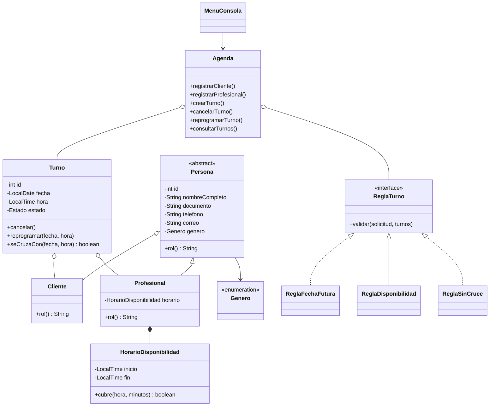

# Fase 1 - Orientada a Objetos (POO) - Sistema de Generacion de Turnos

Version por **consola**, sin base de datos (los datos viven en memoria mientras corre el programa).
NetBeans: File > Open Project > carpeta `backend-fase1-oop` (proyecto Maven, Java 17+). Run: clase `com.pamplona.turnos.Main`.
Opcion 8 del menu carga datos de ejemplo para probar rapido.

## Actores
- **Administrador**: unico que opera el sistema.
- **Cliente** y **Profesional**: actores externos; el sistema solo guarda sus datos.

## Historias de usuario cubiertas
| Historia | Donde esta |
|---|---|
| HU-1 Registrar cliente (nombre completo, documento, telefono, correo, genero; sin documento duplicado) | `Cliente`, `Persona`, `Agenda.registrarCliente` |
| HU-2 Registrar profesional con horario de disponibilidad | `Profesional`, `HorarioDisponibilidad`, `Agenda.registrarProfesional` |
| HU-3 Crear turno (cliente, profesional, fecha y hora futuras) | `Agenda.crearTurno`, `ReglaFechaFutura`, `ReglaDisponibilidad` |
| HU-4 No permitir cruces de horario | `ReglaSinCruce`, `Turno.seCruzaCon`, `CruceDeHorarioException` |
| HU-5 Cancelar o reprogramar turno | `Turno.cancelar/reprogramar`, `Agenda.cancelarTurno/reprogramarTurno` |
| HU-6 Consultar turnos por profesional, cliente o fechas | `Agenda.consultarTurnos` |
| HU-8 Mensajes de error claros | jerarquia `TurnosException`; la consola nunca muestra errores tecnicos |
| HU-9 Respuesta en menos de 1 segundo | cada operacion muestra su tiempo en ms |
| HU-7 CLI y API | Parcial: aqui solo CLI. La API llega en la fase 4 (hexagonal) |

## Conceptos de POO y donde verlos
| Concepto | Ejemplo en el codigo |
|---|---|
| Abstraccion | `Persona` (clase abstracta con `rol()` abstracto); interfaz `ReglaTurno` |
| Herencia | `Cliente` y `Profesional` extienden `Persona`; `CruceDeHorarioException` extiende `ReglaTurnoException`, que extiende `TurnosException` |
| Encapsulamiento | Atributos `private`, sin setters, datos validados en el constructor de `Persona` y `HorarioDisponibilidad` |
| Polimorfismo | `Agenda` recorre una lista de `ReglaTurno` sin saber cual es cual; `Persona.rol()` responde distinto en cada subclase |
| Composicion / asociacion | `Turno` tiene un `Cliente` y un `Profesional`; `Profesional` tiene un `HorarioDisponibilidad` |
| Objeto de valor | `HorarioDisponibilidad` (inmutable); `SolicitudTurno` (record) |
| Excepciones propias | `DatosInvalidos`, `Duplicado`, `NoEncontrado`, `ReglaTurno`, `CruceDeHorario` |
| Igualdad por identidad de negocio | `Persona.equals` compara por documento y tipo |

## Diagrama de clases

## Limites de esta fase
- Sin persistencia (se pierde al cerrar): la persistencia entra en la fase 2 (MVC).
- Sin login ni API: llegan en las fases siguientes.
